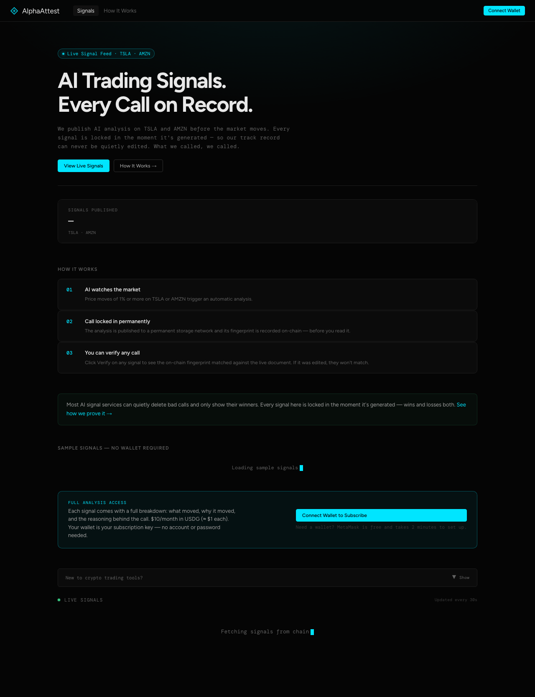
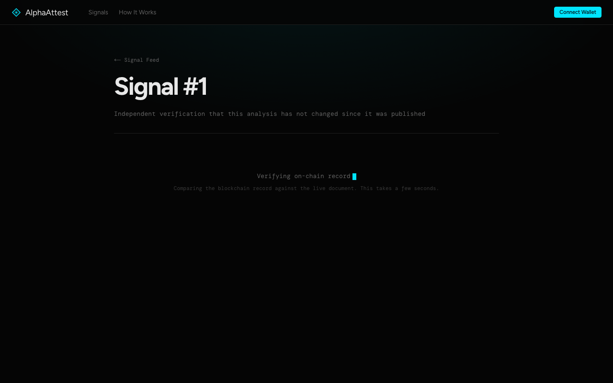

# AlphaAttest

**AI trading signals with cryptographic accountability. Every call permanently locked on-chain before publication.**

Live demo: https://alpha-attest-piznb5xs0-damilolas-projects-fafdf859.vercel.app
Chain: Robinhood Chain Testnet (Chain ID 46630)
Hackathon: [Arbitrum Open House London: Online Buildathon](https://arbitrum-london.hackquest.io/buildathons/Arbitrum-Open-House-London-Online-Buildathon)

---

## The Problem

AI-managed financial assets crossed $1 trillion globally in 2024. Zero of it has cryptographic accountability for AI decision reasoning. Every AI recommendation (from hedge fund algorithms to robo-advisor signals) is unverifiable by design. The AI could have generated the analysis after the price moved, or changed it silently.

## The Solution

AlphaAttest makes every AI financial analysis permanently auditable:

1. A keeper watches TSLA and AMZN prices via Finnhub WebSocket
2. On any >1% price move, Claude generates a 400+ word analysis
3. The analysis is uploaded to IPFS (content-addressed, immutable)
4. The IPFS hash is EIP-712 signed and committed to Robinhood Chain **before** the signal is published
5. Anyone can verify any signal at any time: the on-chain hash must match the live document

If the analysis was edited after publishing, the fingerprints won't match. This is the first cryptographic performance bond for AI investment advice.

---

## Live Contracts (Robinhood Chain Testnet)

| Contract | Address | Role |
|----------|---------|------|
| SignalRegistry | [`0x09522dB7a983a675ba4E19BC9bc0896110b80C6A`](https://explorer.testnet.chain.robinhood.com/address/0x09522dB7a983a675ba4E19BC9bc0896110b80C6A) | Core accountability primitive |
| SubscriptionManager | [`0x566BEAa729E8E1e6cde30446546279BD30e5630d`](https://explorer.testnet.chain.robinhood.com/address/0x566BEAa729E8E1e6cde30446546279BD30e5630d) | USDG-gated access control |
| MockConsumer | [`0x6114270e211C2cd5542D9972caF6F0D51FbA7105`](https://explorer.testnet.chain.robinhood.com/address/0x6114270e211C2cd5542D9972caF6F0D51FbA7105) | ISignalConsumer composability demo |

**Deploy TX:** [0xdd865d8f...](https://explorer.testnet.chain.robinhood.com/tx/0xdd865d8f3346bd4d6c335a64a814bcfa9b3c6ea327b6a5440be11190bdcb4a81)

---

## How It Works

```
Finnhub WS (TSLA/AMZN price feed)
    ↓  >1% move detected
Keeper (Node.js)
    ↓  Claude haiku-4-5 generates 400+ word analysis
Pinata IPFS
    ↓  CID → bytes32 ipfsHash
EIP-712 Signer
    ↓  keeper signs payload
SignalRegistry.commitSignal()  [Robinhood Chain 46630]
    ↓  verifies 4 invariants + signature → stores Signal
MockConsumer.onSignalPublished()
    ↓  reads TSLA ERC-20 balance on Robinhood Chain
Frontend Dashboard
    ↓  any visitor can verify any signal's provenance
```

### SignalRegistry: 7 Features

1. **4 invariants**: ticker allowlist (TSLA/AMZN), proof expiry window (5 min), keeper identity binding, sequence gap detection
2. **EIP-712 signature verification**: keeper signs off-chain, contract verifies on-chain
3. **Accuracy ledger**: tracks CORRECT/INCORRECT outcomes after `resolveSignal()`
4. **ISignalConsumer callbacks**: any contract can register to receive new signals automatically
5. **IPFS hash storage**: `bytes32` SHA-256 digest of full analysis document
6. **SubscriptionManager integration**: USDG-gated access control
7. **MockConsumer**: reads live Robinhood Chain TSLA equity token price on every signal

---

## Integration Depth

| Sponsor | Integration | Depth |
|---------|-------------|-------|
| **Robinhood Chain** | 3 contracts deployed; MockConsumer reads TSLA ERC-20; USDG subscription payments | Deep |
| **Anthropic Claude** | claude-haiku-4-5 generates the analysis; system prompt tuned for financial signal generation | Deep |
| **OpenZeppelin** | EIP712, ECDSA, Ownable, IERC20 across all contracts | Deep |
| **Alchemy** | RPC provider + Notify webhook for real-time signal feed | Moderate |
| **Pinata IPFS** | Primary IPFS pin for every analysis document; Storacha as fallback | Moderate |

---

## Setup

### Prerequisites

- Node.js 20+
- Foundry (`curl -L https://foundry.paradigm.xyz | bash`)
- Funded wallet on Robinhood Chain Testnet ([faucet](https://faucet.testnet.chain.robinhood.com/))

### Contracts (already deployed, read-only)

```bash
cd contracts
forge build
forge test
```

### Keeper

```bash
cd keeper
npm install
cp .env.example .env
# Fill in: FINNHUB_API_KEY, ANTHROPIC_API_KEY, PINATA_JWT, KEEPER_PRIVATE_KEY, ALCHEMY_API_KEY
npm start
```

### Frontend

```bash
cd frontend
npm install
cp .env.local.example .env.local
# NEXT_PUBLIC_* values are pre-filled with deployed contract addresses
npm run dev
```

Open [http://localhost:3000](http://localhost:3000).

---

## Verification

Any signal can be independently verified:

1. Visit `/verify/{signalId}` on the frontend
2. The page reads the `ipfsHash` from the on-chain Signal struct
3. Fetches the IPFS document at that CID
4. Computes the content address and compares to the on-chain hash
5. Match = the analysis is unchanged since publication

Try it on the live demo: `/verify/1`

---

## Screenshots





---

## Tech Stack

| Layer | Technology |
|-------|-----------|
| Smart Contracts | Solidity 0.8.24, Foundry, OpenZeppelin 5.x |
| Keeper | Node.js 20, TypeScript, viem 2.x |
| AI | @anthropic-ai/sdk, claude-haiku-4-5 |
| Storage | Pinata IPFS (primary), Storacha (fallback) |
| Frontend | Next.js 14, wagmi 2.x, viem 2.x |
| Chain | Robinhood Chain Testnet (Chain ID 46630) |
| RPC | Alchemy |

---

## Project Structure

```
AlphaAttest/
├── contracts/          # Solidity contracts + Foundry tests
│   └── src/
│       ├── SignalRegistry.sol      # Core accountability primitive
│       ├── SubscriptionManager.sol # USDG payment gating
│       └── MockConsumer.sol        # ISignalConsumer demo
├── keeper/             # Node.js keeper: watches prices, generates signals
│   └── src/
│       ├── clients/    # Finnhub, Anthropic, Pinata, Storacha, Chain
│       └── orchestrator.ts
├── frontend/           # Next.js dashboard + verify UI
│   └── src/
│       ├── app/        # Pages (dashboard, verify, proof)
│       └── components/ # SignalCard, AnalysisViewer, SampleSignals
└── submission/         # Proof, links, sponsor track documentation
```
